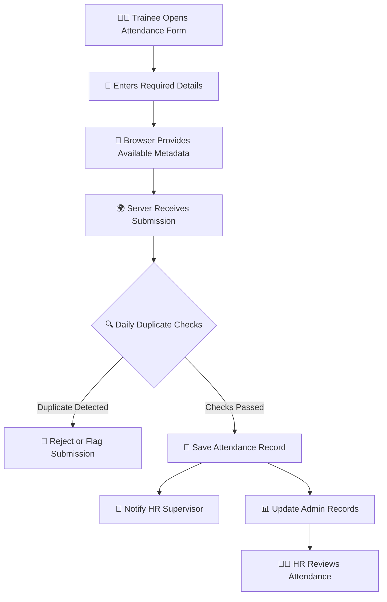

# 🌍 FPT HR REPORT — FIELD PRACTICAL TRAINING TRACKER

<div align="center">

<!-- 🌊 ANIMATED HERO HEADER -->


<!-- ⚡ ANIMATED TYPING EFFECT -->


<br/>

<a href="https://v2.visitkili.com">
  
</a>


<br/><br/>

**🎯 Digitizing Field Practical Training Attendance**

A Flask-based attendance tracking application designed to help tourism and safari businesses record trainee attendance, reduce duplicate submissions, and improve HR visibility through a centralized digital workflow.

**Built for:** Isamani Tours & Safari · Visit Kili Adventures · Kilinge Adventures

<br/>


</div>

---

## 📑 TABLE OF CONTENTS

- ✨ Overview
- 🚀 Core Features
- ⚙️ How It Works
- 🛡️ Security & Verification
- 📊 HR Dashboard
- 🖥️ Technology Stack
- ⚡ Quick Installation
- 🔐 Gmail Configuration
- 🧑‍💼 Admin Access
- 📁 Project Structure
- 🧪 Testing Checklist
- 🛣️ Future Improvements
- 👨‍💻 Credits & TSAP Branding

---

## ✨ 01. PROJECT OVERVIEW

<div align="center">


</div>

**FPT HR Report** is a digital attendance monitoring system created for field practical training operations in the tourism and safari industry.

Instead of relying entirely on manual attendance records, trainees can submit their details through an online form while the system collects available verification signals and stores attendance records for HR review.

### 🎯 Project Objectives

| Objective | Description |
|---|---|
| 📝 Digital attendance | Record trainee names and registration numbers |
| 🏢 Company identification | Associate submissions with a company |
| 📱 Device awareness | Capture selected browser and device characteristics |
| 🌐 Network logging | Record the submitting IP address where available |
| 📍 Location support | Request geolocation when permission is granted |
| 🚫 Duplicate reduction | Apply daily submission restrictions |
| 📧 HR notifications | Email supervisors about new submissions |
| 📊 Centralized monitoring | Review records through an admin dashboard |

---

## 🚀 02. CORE FEATURES

<div align="center">


</div>

### 📝 Smart Attendance Registration

Trainees submit their attendance information through a web form.

- 👤 Full name
- 🎓 Registration number
- 🏢 Company selection or entry, depending on the configured form
- 🕒 Submission date and time
- 🌐 Available request and device metadata

### 📱 Device Fingerprinting

The application can collect browser-exposed device characteristics, including:

- 🖥️ Screen dimensions
- 🎨 Canvas fingerprint data, if implemented in the client
- 🌍 Browser timezone
- 🗣️ Browser language
- 🧭 User-agent string

These signals can help identify repeated submissions, but **they are not guaranteed to uniquely identify a device**. Browser settings, privacy protections, updates and shared devices can affect results.

### 🌐 IP Address Logging

Record the apparent client IP address available to the application.

When deployed behind a reverse proxy, configure trusted proxy handling correctly. Do not blindly trust forwarded IP headers supplied by clients.

### 📍 Optional Geolocation

When supported by the browser and approved by the trainee, the system can request location information.

- 🗺️ Location permission is controlled by the user.
- 🔒 Location collection should be disclosed to trainees.
- 📌 Location accuracy depends on the device, browser and available signals.
- 🚫 Denied location permission should not silently be treated as proof of misconduct.

### 🚫 Duplicate Submission Controls

The documented workflow includes:

- One submission per device per day.
- One submission per registration number per day.

These checks help reduce duplicate records. They do not prove that a trainee is physically present or completely prevent proxy attendance.

### 📧 Automated Email Notifications

Send a notification to the designated supervisor after a successful submission.

Configure the sender account, recipient and Gmail application password using environment variables.

### 📊 HR Admin Dashboard

Review recorded attendance through the administrative interface.

**Admin route:** `/admin?token=yourtoken`

Use a strong secret, HTTPS, and appropriate authentication controls. Avoid sharing administrative URLs containing tokens in screenshots, public repositories or messages.

---

## ⚙️ 03. HOW IT WORKS

<div align="center">



</div>

### 🔄 Attendance Lifecycle

1. **Open:** A trainee visits the attendance website.
2. **Register:** The trainee enters the required details.
3. **Verify:** The server applies its configured daily duplicate checks.
4. **Record:** Accepted submissions are stored in the database.
5. **Notify:** The configured supervisor receives an email notification.
6. **Review:** HR personnel inspect the available records through the admin dashboard.

---

## 🛡️ 04. SECURITY, PRIVACY & ACCOUNTABILITY

<div align="center">


</div>

Attendance data and device metadata should be handled responsibly.

### 🔐 Recommended Production Safeguards

- Store secrets in environment variables, never directly in source code.
- Use HTTPS for all public attendance pages and administrative access.
- Protect admin routes with proper authentication and authorization.
- Add rate limiting and server-side validation.
- Enforce duplicate restrictions using database constraints or transactions where appropriate.
- Use parameterized database queries or an ORM.
- Keep database files and environment files out of public repositories.
- Apply role-based permissions if multiple HR staff members use the system.
- Restrict access to personal and location information.
- Establish a reasonable data retention and deletion policy.
- Maintain backups and test database recovery.
- Log administrative actions without unnecessarily exposing sensitive information.

### ⚠️ Important Limitations

Device fingerprints, IP addresses and browser geolocation are **signals, not definitive proof of identity or physical presence**.

A VPN or proxy does not automatically make a submission fraudulent, and multiple trainees may legitimately share a device or network.

For stronger attendance assurance, combine technical controls with a transparent HR verification process.

---

## 🖥️ 05. TECHNOLOGY STACK

<div align="center">


<br/><br/>

| Technology | Purpose |
|---|---|
| 🐍 Python | Backend application logic |
| ⚗️ Flask | Web framework |
| 🌐 HTML / CSS / JavaScript | Web forms and interface |
| 🗄️ SQLite | Local attendance database |
| 📧 Gmail SMTP | Supervisor email notifications |
| 📍 Browser Geolocation API | Optional location requests |
| 🔧 Git & GitHub | Source control and collaboration |

</div>

---

## ⚡ 06. QUICK INSTALLATION

### 📋 Requirements

- Python 3.10 or a compatible version supported by the project's dependencies
- Git
- pip
- Gmail account with an application password, if using Gmail SMTP

### 🚀 Step 1 — Clone the Repository

```bash
git clone https://github.com/cleven12/ismani_fpt_att.git

cd ismani_fpt_att
```

### 🐍 Step 2 — Create a Virtual Environment

**Windows — PowerShell**

```powershell
python -m venv venv
.\venv\Scripts\Activate.ps1
```

**Windows — Command Prompt**

```bat
python -m venv venv
venv\Scripts\activate
```

**Linux / macOS**

```bash
python3 -m venv venv
source venv/bin/activate
```

### 📦 Step 3 — Install Dependencies

```bash
python -m pip install --upgrade pip
pip install -r requirements.txt
```

### 🔑 Step 4 — Configure Environment Variables

Copy the example configuration:

**Windows PowerShell**

```powershell
Copy-Item .env.example .env
```

**Linux / macOS**

```bash
cp .env.example .env
```

Open `.env` and configure the variables required by your application, including:

```dotenv
# Example placeholders only — use the actual names
# defined in your application's configuration.

SECRET_KEY=replace_with_a_long_random_secret
ADMIN_TOKEN=replace_with_a_strong_unique_token

MAIL_USERNAME=your_email@example.com
MAIL_PASSWORD=your_gmail_app_password
```

Check `app.py` and `.env.example` for the exact environment variable names used by your repository. Do not commit your real secrets.

### ▶️ Step 5 — Start the Application

```bash
python app.py
```

Open:

**http://localhost:5000**

> 📍 Browser geolocation generally requires HTTPS in production. Localhost is normally treated as a secure context for development.

---

## 📧 07. CONFIGURE GMAIL APP PASSWORD

<div align="center">


</div>

To enable supervisor email notifications:

1. Visit [Google Account Security](https://myaccount.google.com/security).
2. Enable 2-Step Verification.
3. Open [Google App Passwords](https://myaccount.google.com/apppasswords), if the feature is available for your account.
4. Generate an app password for the application.
5. Add the password to the relevant environment variable in `.env`.
6. Verify the SMTP configuration and send a test notification.

**Security reminders:**

- Never publish an app password in GitHub.
- Do not use your normal Gmail password as an SMTP app password.
- Revoke exposed or unused app passwords.
- Use an approved alternative email provider if app passwords are unavailable for your account.

---

## 🧑‍💼 08. ADMIN DASHBOARD

<div align="center">


<br/>

### 📊 HR CONTROL CENTER

**Review attendance records. Monitor submissions. Support better decisions.**

</div>

### 🔗 Administrative Route

```text
https://v2.visitkili.com/admin?token=YOUR_ADMIN_TOKEN
```

Replace `YOUR_ADMIN_TOKEN` with your configured token.

This route reflects the documented access pattern; it does not guarantee that the live server is currently reachable or that the dashboard has all recommended security controls.

### 🛡️ Production Recommendation

For a production HR application, prefer authenticated admin sessions, secure cookies, CSRF protection where applicable, permission checks, login rate limits and audit logging instead of relying exclusively on a token in a URL.

Tokens in URLs may leak through browser history, logs, screenshots or referrer information.

---

## 📁 09. PROJECT STRUCTURE

```text
ismani_fpt_att/
│
├── app.py                 # Main Flask application
├── requirements.txt       # Python dependencies
├── .env.example           # Example environment settings
│
├── templates/
│   ├── index.html         # Trainee attendance form
│   └── admin.html         # HR administration dashboard
│
└── instance/
    └── attendance.db      # Local SQLite database
```

The SQLite database is created automatically only if the application code initializes it that way. The actual database location and initialization process depend on the implementation in `app.py`.

---

## 🧪 10. TESTING CHECKLIST

Before deploying changes, verify the following behaviors:

- [ ] Attendance form loads successfully.
- [ ] Required trainee fields are validated on the server.
- [ ] Valid submissions are saved correctly.
- [ ] Repeated registration numbers are handled according to the daily rule.
- [ ] Repeated device signals are handled according to the configured policy.
- [ ] Legitimate shared-device cases can be reviewed fairly.
- [ ] Email notifications work and failures are logged safely.
- [ ] Location denial does not break attendance submission unexpectedly.
- [ ] Invalid administrative credentials are rejected.
- [ ] Secrets are excluded from version control.
- [ ] Database backup and recovery have been tested.
- [ ] The application uses HTTPS in production.

---

## 🛣️ 11. FUTURE IMPROVEMENTS

<div align="center">


</div>

Potential upgrades for future versions:

- 📊 **HR Analytics:** Attendance summaries and date-range reports.
- 📥 **Export Center:** CSV and Excel exports for authorized HR users.
- 👥 **Multi-User HR:** Individual accounts and role-based permissions.
- 📱 **Mobile-First UI:** A polished experience on phones and tablets.
- 🗓️ **Training Calendar:** Track trainee schedules and placement periods.
- 📧 **Notification Center:** Retry failed emails and view delivery status.
- 🧾 **Audit Trail:** Track changes to attendance records.
- ☁️ **Reliable Backups:** Automated backup and recovery procedures.
- 🔎 **Review Queue:** Flag suspicious duplicate patterns for human review.
- 🌍 **Swahili & English:** A bilingual interface for local and international teams.
- 📈 **Management Reports:** Summaries for authorized managers and supervisors.

These are proposed enhancements, not claims that they are already implemented.

---

## 👨‍💻 12. PROJECT CREDITS

<div align="center">


### 💻 DIGITAL SOLUTIONS • WEB DEVELOPMENT • AUTOMATION

**Technology, creativity and practical digital solutions.**

</div>

### 🚀 TSAP — Technology & Digital Services

**JOHN ONLINE SERVICES AND APPLICATIONS (TSAP)** is a digital services brand focused on practical online solutions, web development, automation and technology support.

Explore our work and services:

- 🌐 **Service Website:** [johnonlineservices.netlify.app](https://johnonlineservices.netlify.app)
- 💼 **Digital Solutions:** Web applications, business systems and automation
- 🎨 **Creative Technology:** Digital experiences and online service solutions

### 🤝 Collaboration

Interested in digital transformation, web applications, business automation or practical technology solutions?

Connect with **JOHN ONLINE SERVICES AND APPLICATIONS** to explore opportunities for collaboration.

---

<div align="center">


<br/>


**⭐ If this project is useful, consider starring the repository and contributing improvements.**

*FPT HR Report — making field training attendance more organized, transparent and manageable.*

**Created by JOHN ONLINE SERVICES AND APPLICATIONS (TSAP)**

</div>

---

### 📜 DISCLAIMER

This README documents the stated project scope and suggests additional improvements. Actual functionality, security guarantees and deployment status must be verified against the source code and live application. Use trainee data responsibly and obtain appropriate notice or consent for personal data collection.
